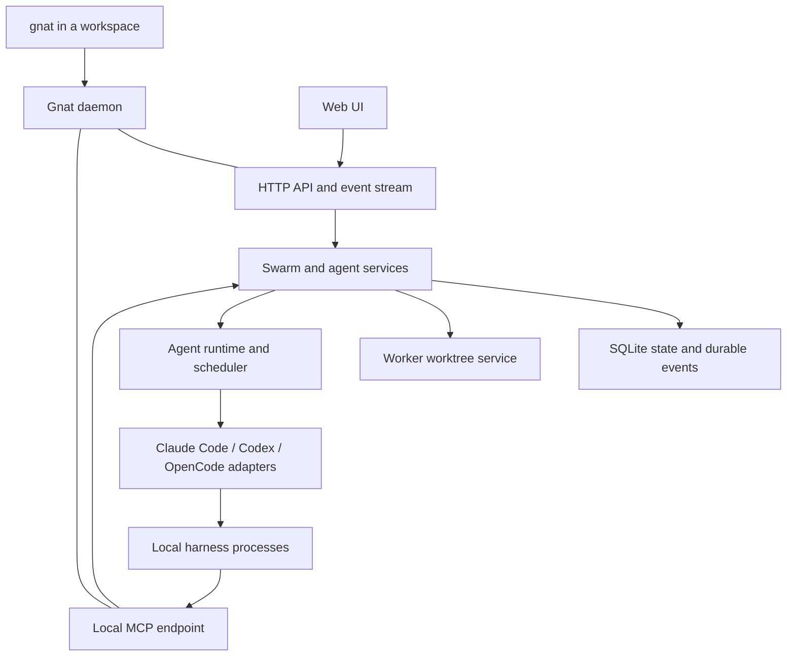

# Gnat design and specification

Gnat is a local application for directing a dynamic team of coding agents through
one persistent orchestrator. This document records its product contract;
`agents/architecture.md` describes the implementation. The executable embeds its
browser assets and runs trusted local processes on macOS.

## 1. Product contract

The normal entry point is:

```sh
cd ~/src/foo
gnat
```

Gnat starts the user's daemon if necessary and opens the web UI in the default
browser, focused on the swarm for that workspace. An existing swarm resumes its
saved identity and history. A new swarm has exactly one orchestrator and no
workers. Once the configured harness is available, the user can type a
request such as "implement feature X" directly into the orchestrator's chat.

The orchestrator creates workers, assigns tasks, handles questions, integrates
their changes, and verifies the combined result. The orchestrator works directly
in the checkout where Gnat was invoked; workers use separate Git worktrees. The
user observes the team in the UI and continues the conversation with the
orchestrator. The combined result is already in the user's checkout.

Gnat manages execution and preserves work. Agents organize the work through
conversation: they decide how to divide it, ask for help, report results, and
assess completion. Gnat records their messages and observable execution state
without imposing a task-management protocol.

### Agreed decisions

1. Agents run locally as trusted processes, using Git worktrees.
2. Every swarm has one orchestrator, which is the user's entry point for work.
3. The orchestrator appears in a sidebar on the right, with its transcript and
   a chat input. The rest of the UI exposes the workers and their activity.
4. The core is harness neutral. Harness integrations are modular adapters,
   compiled into Gnat; no dynamically loaded plugin system is required.
5. Supported harnesses are Claude Code, Codex, and OpenCode 2.
6. Any supported harness can run the orchestrator or a worker. Swarms can mix
   harnesses.
7. One daemon per user serves multiple swarms through one web UI. Each workspace
   has at most one swarm.
8. Agents receive resolved harness settings and ordinary prompts without profiles.
9. The orchestrator can add and remove workers while the swarm is running.
   Workers cannot create or remove Gnat agents.
10. The orchestrator uses the original checkout as its working directory. Each
    worker gets a separate managed Git worktree.
11. The orchestrator integrates worker results directly into the original
    checkout using ordinary Git operations. Gnat has no separate delivery step.
12. Removing a worker stops its execution and removes its managed resources,
    using ordinary Git safeguards. Its messages remain in swarm history.
13. The orchestrator has a persistent conversation across requests and daemon
    restarts. Explicitly starting a new conversation preserves the swarm and
    workers.
14. Gnat supplies coordination tools over an MCP server embedded in the daemon,
    using Streamable HTTP on loopback. Each adapter configures that connection
    automatically for its agent.
15. The daemon owns message persistence and delivery. MCP notifications are not
    assumed to start a model turn.
16. Git uses ordinary branches, worktrees, remotes, and user credentials.
17. Agents coordinate through ordinary messages. Gnat has no task records,
    task states, or required completion-report operation.
18. The config file must specify the orchestrator's harness, model, and effort.
    Missing values are errors; there is no first-run selection flow.
19. Gnat leaves native harness delegation behavior unchanged. Native subagent
    activity belongs within the parent agent's transcript, with no additional
    delegation policy or dedicated UI.
20. Agents handle development setup in worker worktrees using ordinary shell
    commands and repository instructions. Gnat adds no setup hooks, automatic file
    copying, or development-service management.
21. Stopping a swarm interrupts active turns and prevents new ones, preserving
    conversations, queued messages, workers, and worktrees. Resuming enables
    scheduling and delivery of queued messages without replaying interrupted
    turns. Closing the browser does not affect execution.
22. Gnat does not support workspace relocation. If a saved checkout path
    disappears, report it and preserve the swarm's data without searching for
    the repository or attaching the swarm elsewhere.
23. Workspace unregistering and workspace cleanup are outside current scope.
    Stopped swarms remain listed with their history and worker worktrees intact.
    The orchestrator can still remove individual workers and their resources.
24. Gnat supports macOS only. Linux and Windows support are deferred.
25. Automatic process cleanup and reconciliation after a daemon crash are
    outside the current scope. The user cleans up surviving processes before
    resuming work.
26. Git changes, diff/review, and GitHub UI are deferred to a follow-up. Keep
    Git inspection separate from chat and retain workspace/agent identity and
    checkout metadata so those views can be added without redesigning the core.
27. The initial public command surface is `gnat`, `gnat --no-open`,
    `gnat --help`, `gnat --version`, and `gnat daemon stop`. Daemon startup is
    automatic.

### Prerequisites and scope

An initial installation needs Gnat, Git, and at least one installed and
authenticated supported harness. A committed local Git repository is sufficient;
Docker, GitHub, a remote, and `gh` are not prerequisites. Gnat should explain
missing prerequisites in the UI and allow the user to retry without losing the
new swarm's identity.

Agents use the user's normal local privileges and development tools. Worktrees
separate ordinary edits and indexes; they are not a security boundary. Gnat does
not promise filesystem isolation, credential isolation, or enforcement against
agents using ordinary shell commands outside their assigned worktree.

## 2. Concepts and ownership

| Concept | Meaning and owner |
| --- | --- |
| Workspace | A registered user checkout, discovered from the invocation directory; the daemon records its identity and location. |
| Swarm | The persistent team attached to one workspace, including its orchestrator, workers, queues, and history. |
| Agent | A stable identity, role, harness configuration, working directory, and conversation history; the orchestrator uses the original checkout and workers use managed worktrees. |
| Conversation | One harness session lineage for an agent; starting a new conversation creates a new lineage without replacing the agent. |
| Turn | One execution of a harness against delivered input; ending a turn does not establish that the agent's work is complete. |
| Message | A durable input or notification with a sender, recipient, and delivery state. |

The daemon owns all authoritative Gnat state and serializes transitions. The
browser presents state and submits user actions. Harnesses own their internal
conversation formats; Gnat records the identifiers and local state locations
needed to resume them.

Agent and swarm IDs are immutable and independent of display names. Names may
change without reconnecting old history to a new agent. Branch and directory
allocation uses immutable IDs to avoid accidental reuse.

## 3. Architecture



The MCP and browser APIs are thin adapters over the same application services.
Neither implements a second scheduler, independent lifecycle rules, or its own
authoritative state store.

Proposed package responsibilities:

| Area | Responsibilities |
| --- | --- |
| Entry point | Workspace discovery, daemon discovery/startup, browser opening, minimal maintenance commands. |
| Daemon | Single-instance ownership, listeners, service composition, shutdown, recovery. |
| Core services | Swarms, agent roles, message queues, lifecycle transitions, and execution scheduling. |
| Store | Versioned SQLite schema, transactions, ordered event history, read models. |
| Worktrees | Repository discovery, worker branch/worktree allocation and removal, and Git inspection. |
| Harness contract | Neutral configuration, session lifecycle, capabilities, normalized input and output. |
| Harness adapters | Provider protocols, local configuration, authentication discovery, process execution, event translation. |
| MCP | Tool schemas, caller binding, role checks, tool results, dispatch to core services. |
| Web | Browser API, embedded UI assets, snapshot and event streaming. |

Core packages must not import concrete harness adapters, and browser components
must not parse provider-specific protocol messages.

## 4. Startup and workspace identity

### Launch sequence

1. Resolve the current directory to its Git working-tree root. Invocations from
   subdirectories select the same workspace.
2. Canonicalize the path, including symlink resolution, and record the Git common
   directory for worktree operations.
3. Find the per-user daemon's private runtime descriptor and perform a readiness
   handshake. If absent, start the daemon under a single-instance lock.
4. Ask the daemon to open or register this workspace. A database uniqueness rule
   prevents concurrent invocations from creating duplicate swarms.
5. Return the workspace-specific browser URL and open it in the default browser.
   With `--no-open`, print the URL without opening a browser.
   If browser opening fails, print that URL and leave the usable daemon running.
6. For a new swarm, load the orchestrator's harness, model, and effort from the
   config file. Report an error identifying any missing required values. Validate
   the configured harness and create its session in the original checkout
   before marking it ready for the first user prompt.

The command returns after the daemon accepts the request and the browser launch
is attempted. It does not remain attached to a terminal to keep agents alive.
Repeated invocations must reuse the daemon and swarm.

### Workspace identity

A workspace is a canonical checkout root, rather than an entire Git
common directory. Two separately registered user worktrees of the same
repository may therefore have different swarms. Shared Git metadata must still
be respected, and all allocated agent branches must be unique across them.

Gnat-managed worktrees are associated with their owning workspace. Invoking
`gnat` from one of them opens that swarm instead of registering a recursive
workspace. Worktree ownership is recorded explicitly, not guessed from a branch
name or a directory prefix.

Repositories with no initial commit, bare repositories, and missing or moved
workspace roots receive clear errors. Gnat does not support workspace
relocation. If a saved checkout path disappears, preserve the registration and
swarm data and report the saved location. Do not recreate the path, search for
the repository, or attach the existing swarm elsewhere.

Gnat has no workspace unregister operation. Stopping a swarm leaves its
workspace listed and preserves its history and worker worktrees. This does not
change individual worker removal, which deletes that worker's managed resources
using the safeguards described in section 7.

### First-run configuration

The config file must explicitly set the orchestrator's harness, model, and
effort. If any value is missing, report a configuration error identifying the
missing setting. There is no automatic selection, inferred default, or first-run
configuration UI. The user edits the config file and retries.

The daemon probes installations and credentials through adapters. It does not
collect provider secrets in a new Gnat login flow or automatically install
software. Unsupported versions and authentication failures must be distinct
from "no harness installed."

## 5. Daemon and process lifetime

One per-user daemon owns every registered swarm, the web server, the MCP endpoint,
and managed harness processes. It binds to loopback and records its actual
address in a private runtime descriptor. Browser URLs use swarm/workspace IDs,
so routing does not depend on whichever directory most recently launched Gnat.

The initial implementation uses a detached process started on demand. Automatic
launch at OS login is optional future work. Closing a tab or terminal does not
stop agents. An explicit daemon shutdown stops scheduling, interrupts active
turns, closes adapters, waits for managed children, and flushes state.

The runtime must handle process groups and adapter shutdown explicitly. A
harness crash is contained to its agent; it must not terminate the daemon or
other swarms. Stopping one swarm does not stop other swarms.

Automatic process cleanup and reconciliation after a daemon crash are outside
the current scope. Harness processes may survive a daemon crash; the user is
responsible for cleaning them up before resuming work. Gnat does not need to
adopt surviving processes or guarantee that a crash leaves no orphaned or
duplicated processes. Normal stop and orderly shutdown still stop managed
execution as described above.

Swarm switching is a view change and does not pause a team. The UI offers
explicit pause/resume and stop controls. Pausing stops new turns; interrupting
ends current execution. A paused swarm retains messages for later delivery.

Stopping a swarm prevents new turns and interrupts all active turns in that
swarm. Conversations, queued messages, workers, and worktrees remain intact.
Resuming enables scheduling again, including delivery of queued messages; it
does not automatically replay interrupted turns. Closing the browser has no
effect on execution.

## 6. Worktrees, branches, and integration

### Allocation

The orchestrator runs in the original checkout resolved during workspace
discovery. Gnat does not create a worktree or branch for it. It sees the existing
files, index, and current HEAD, including dirty, staged, untracked, and ignored
content. Starting Gnat does not stash, commit, reset, or copy that content.

Each worker gets a linked worktree of the same repository, stored outside the
original checkout in Gnat-managed storage. No secondary mirror or managed clone
is needed. All agents can inspect committed objects in the common repository
without pushing or fetching through Gnat.

Record each agent's working directory and repository identity. For workers,
also record the allocated branch and initial commit. Proposed worker branch
names are `gnat/<swarm-id>/<agent-id>`. Human-readable names are UI labels and
must not be the only protection against branch collisions.

Workers normally start from the original checkout's committed HEAD at creation
time. Its uncommitted and ignored files are not automatically copied into worker
worktrees. The orchestrator may select another valid committed base for a review
or other work. Resolve a ref to an object ID once and save that ID; worker
startup must not race a moving branch reference.

Creation never resets an existing branch or adopts an unrelated directory after
a collision. Git's normal restriction on checking out the same branch in
multiple worktrees remains in effect.

### Collaboration and integration

Workers edit and commit in their own worktrees and share results through
messages, including branch and commit references when useful. The orchestrator
reviews and integrates their changes directly in the original checkout using
ordinary Git operations, then runs the appropriate verification there. Agents
inspect Git and reconcile branches when reusing workers; Gnat does not enforce
a base or integration sequence for each piece of work.

Gnat does not require pushing, opening a pull request, or using GitHub to share
work between agents. Agents may use installed `git`, `gh`, and other tools with
the user's ordinary authentication when the work calls for them. Gnat does
not replace their remotes or enforce branch-prefix permissions.

Gnat creates the worker worktree. Agents handle project dependencies, ignored
configuration such as `.env`, generated files, shared services, and port
allocation using ordinary shell commands and repository instructions. Gnat adds
no setup hooks, automatic file copying, or development-service management.

## 7. Agent lifecycle

Every swarm records exactly one orchestrator identity. It may be starting,
unavailable, paused, or interrupted; those conditions do not make the swarm an
orchestrator-free team. Workers cannot replace or remove it. Recovery uses its
saved identity and conversation rather than creating an unnoticed replacement.

Keep agent lifecycle and execution state separate:

| State dimension | Proposed values |
| --- | --- |
| Agent lifecycle | provisioning, active, removing, provisioning_failed |
| Execution | idle, queued, running, interrupted, unavailable |

Pause is a scheduling setting at swarm or agent scope. Idle means no turn is
running and no input is queued; it does not mean the work is finished. Agents
communicate progress, questions, and results through messages. Gnat does not
infer task status from their text or from a turn ending.

### Creating a worker

Creation records an immutable agent ID, display name, role, harness settings,
initial prompt, and resolved base commit. It then allocates the branch and
worktree, prepares the adapter, and delivers the initial prompt as a durable
message when provisioning is complete and scheduling is enabled.

The operation returns promptly with the agent ID, allocated branch/path, and
current provisioning state. "Created" and "ready to execute" are distinct. If
setup later fails, preserve the agent record and report the failure to the
orchestrator; never leave a permanently invisible partial worktree.

Database and filesystem/process changes cannot be one transaction. Record
provisioning stages durably and reconcile them after a crash. Retrying the same
creation request must reuse its agent identity rather than create duplicate
workers. Clean up only artifacts known to belong to that failed operation and
preserve anything containing user or agent work.

### Continuing work

An active worker can receive further instructions through ordinary messages,
using the same worktree and conversation. Agents decide whether to continue,
redirect, or divide work and how to communicate results. Gnat persists and
delivers those messages without requiring a task ID, a completion declaration,
or a transition between pieces of work. Turn outcomes remain observable
independently of anything an agent reports in a message.

### Removing a worker

The orchestrator decides when a worker and its work are no longer needed.
Removal closes scheduling, interrupts any active turn, waits for managed
execution to stop, and removes the worker's worktree, branch, and Gnat-owned
adapter resources. Use ordinary Git safeguards; if removal is refused, report
the reason and leave the remaining resources in place for the orchestrator to
resolve rather than forcing deletion.

Queued messages receive explicit cancellation records. The worker leaves the
team, and messages targeting it are rejected. Existing messages and events keep
their original attribution in swarm history. There is no separate retirement,
reactivation, or retained-worker cleanup workflow.

## 8. Coordination through MCP

### Endpoint and caller identity

The daemon exposes a local Streamable HTTP MCP endpoint. Every agent receives
connection settings containing an agent-specific credential bound to its swarm,
identity, and role. The server resolves the caller from that binding; tool
arguments never select the sender or widen the caller's swarm scope.

Role-specific tool discovery keeps irrelevant tools out of worker context.
Execution also checks the role, even if a caller guesses a hidden tool name.
These rules express Gnat's workflow and prevent ordinary targeting mistakes;
they do not turn trusted local agents into isolated security principals.

Adapters inject the MCP configuration into Gnat-managed launches/sessions.
They must not edit the user's global MCP settings or add generated Gnat files
to the repository. Daemon restart reconnects sessions with valid connection
configuration; ephemeral connection credentials are not durable agent identity.

### Proposed initial tools

These six tools provide communication, inspection, and agent lifecycle control.
Names and parameter schemas below are proposed contracts.

| Tool | Caller | Inputs and behavior |
| --- | --- | --- |
| `list_agents` | All agents | Return current agents in this swarm, their roles, harness/model settings, execution status, branches, and working directories. |
| `send_message` | All agents | Recipient ID and message text; record and enqueue a message from the authenticated caller. |
| `create_agent` | Orchestrator | Display name, initial prompt, optional harness/model/effort, and optional base ref; allocate a worker asynchronously and enqueue its initial prompt. |
| `interrupt_agent` | Orchestrator | Worker ID and optional reason; interrupt the identified active turn without discarding its history or queue. |
| `remove_agent` | Orchestrator | Worker ID; stop execution and remove the worker's managed resources using ordinary Git safeguards. |
| `read_agent` | All agents | Agent ID and bounded history cursor; return recent conversation history and execution outcomes, including history from removed workers, without dumping an entire transcript by default. |

Tool responses return stable IDs and structured state with a concise readable
summary. Errors distinguish invalid inputs, unknown/removed targets, invalid
transitions, refused removal, unavailable harnesses, and retryable transport
failures.

Mutations carry request IDs so transport retries can retrieve the original
result. Adapters should preserve the provider tool-call ID where available.
Do not deduplicate distinct deliberate messages merely because their text is
identical, or claim exactly-once execution of arbitrary shell side effects.

`create_agent` without explicit harness settings uses saved worker defaults,
falling back to the orchestrator's usable harness configuration. Resolved
settings are saved on the agent, so changing defaults does not reconfigure
existing workers.

MCP supplies communication and worker lifecycle control. Git inspection,
editing, and integration use the harness's existing local tools. Workers do not
receive team-management capabilities.

### Instructions

Gnat supplies the orchestrator with the coordination tool contract, current
team state, worktree rules, and its responsibility to assemble and verify
results. It supplies workers with their identity, branch/path, and communication
tools. Agents choose how to divide work and report back through conversation.

These are built-in role instructions plus ordinary messages. There are no
agent or swarm profiles. Repository instructions continue to apply through the
normal harness mechanisms. Generated instructions and settings must remain
outside tracked repository content and must not overwrite existing project
instructions.

## 9. Messaging, turns, and scheduling

Messages are durable records with an ID, sender, recipient, timestamp, and
delivery state. User chat, teammate messages, and runtime failure notifications
all use the same scheduling path. Questions, progress, and results are ordinary
message text, without special message kinds or delivery rules.
System-generated messages clearly identify their origin.

Only one turn runs per agent. The daemon transactionally claims queued input
and marks its turn running before starting the harness. There must be no state
in which accepted input is neither queued nor associated with a turn. The
durable record is the acceptance boundary for browser and MCP responses.

When an idle, unpaused agent receives input, schedule a turn. During an active
turn, retain input for delivery at a supported boundary. Adapters may support
mid-turn steering; the baseline behavior queues it for the next turn. The UI
distinguishes accepted, queued, delivered, and failed messages where relevant.

MCP server notifications do not substitute for this path. A tool call to send a
message records input; the scheduler and recipient's adapter cause the model
to receive it. Coordination must work without a polling loop, long-running
`wait` tool, or an orchestrator turn left open waiting for workers.

One received message starts one turn by default. Coalescing a burst of worker
notifications is an optional optimization only if individual message identities
and delivery records remain intact. Bound automatic retry behavior to avoid
runaway loops when a harness repeatedly fails.

Interrupt requests target a specific turn ID. A late interruption must never
terminate a subsequent turn. Closing an adapter is distinct from cancelling a
turn: a persistent harness process may serve several consecutive turns.

### Recovery

On startup, mark persisted running turns interrupted, retain their recorded
input and output, and expose an explicit continuation/retry action. This does
not establish that surviving harness processes have stopped; after a daemon
crash, process cleanup is the user's responsibility. Do not silently replay a
started task: it may already have edited files, committed, sent a message, or
pushed a branch.

Messages that were never claimed remain queued. Interrupted running messages
are not automatically returned to that queue. Resume saved harness conversations
when possible; failed session resumption is a visible error, not permission to
start an empty conversation under the same history.

Worker failures and interruptions become durable notifications for the
orchestrator. Continuing an interrupted request requires explicit direction;
resuming scheduling allows queued messages to run without automatically
replaying that request. Stopped or paused swarms remain stopped or paused across
daemon restart.

## 10. Harness adapter contract

The core speaks in Gnat concepts: agent, conversation, input, event, capability,
and execution outcome. A concrete adapter translates those to a harness's
protocol and configuration.

An adapter must support:

- Discovering the installed executable, compatible version, and usable local
  authentication, with actionable errors.
- Reporting supported configuration and capabilities, including models/effort
  where discoverable, interruption, resumption, and optional mid-turn delivery.
- Creating a conversation with an absolute working directory, Gnat instructions,
  resolved settings, local session-state locations, and MCP connection settings.
- Resuming an exact saved conversation, or reporting why it cannot be resumed.
- Running one turn, emitting normalized events, and reporting its outcome.
- Interrupting an identified turn and closing owned process resources.
- Persisting the neutral session reference Gnat needs for a later restart.

The core depends on the neutral adapter contract. Session creation and
execution may involve a persistent subprocess or a process per turn, according
to the adapter.

### Initial integrations

| Harness | Proposed integration |
| --- | --- |
| Claude Code | Adapt the existing structured execution integration for native paths, per-agent conversation identity, injected instructions, and MCP configuration. |
| Codex | Adapt the existing app-server integration, preserving explicit thread identity, normalized events, cancellation, and session resumption. |
| OpenCode 2 | Use its built-in `opencode acp` process initially; configure the working directory, MCP server, session, and model through the supported ACP contract. |

ACP is an implementation detail of the OpenCode adapter. The core need not use
ACP for every harness or interpret OpenCode extensions. Compatibility versions
must be checked against the current official documentation during implementation.

### Local authentication and configuration

Use the user's existing harness authentication and installed development tools.
Gnat does not require a separate credential store for these harnesses.

Separate conversations and Gnat-owned configuration without blindly assigning a
new empty `HOME`: that can hide credentials, toolchains, Git configuration, and
user settings. Each adapter must use supported per-launch/session overrides and
private runtime/session files while preserving normal local authentication.

Configuration changes apply to new agents/conversations by default. A harness
change cannot pretend to resume another harness's conversation. Runtime harness
switching and cross-harness conversation conversion are outside initial scope.

Gnat leaves native harness delegation behavior unchanged. Harness-native
subagents remain distinct from Gnat workers and do not acquire independent Gnat
identities, Gnat-managed worktrees, or independent team-management authority.
Their activity belongs within the parent agent's transcript, attributed where
the harness protocol exposes it. Gnat adds no delegation policy or dedicated
subagent UI. The Gnat worker-creation restriction applies to Gnat's tools, not
native harness features.

## 11. Conversations and reset behavior

The orchestrator's conversation persists across user tasks and daemon restarts.
Workers also retain their own independent sessions while their agents exist.
Gnat keeps a complete displayable history even when a harness compacts its
internal context; the two histories have different purposes.

An explicit "new conversation" action creates a new conversation ID while
preserving the orchestrator's agent identity, original working directory,
workers, queued messages, and prior transcript. It does not change the checkout
or its branch. The previous conversation remains inspectable.

Reset must occur at a settled turn boundary. If execution is active, the UI
offers interruption before performing the reset. Do not race old-session
messages into the new session.

The new session receives a bounded orientation describing the workspace,
active workers and their execution state, and queued messages, with tools to
inspect prior conversations. This orientation comes
from saved runtime records. The agent recovers the meaning and progress of the
work from conversation history; Gnat does not maintain a separate task summary
or registry of outstanding questions. Queued messages are identified in the
orientation and delivered through the normal scheduler.

## 12. Persistence and event model

Use versioned SQLite storage as the authoritative record of workspace/swarm
identity, agent configuration, conversations, messages, turns, and ordered
events. Repository content remains in Git and worktree files; harness session
content remains in the harness's own format.

A proposed persistent layout is:

```text
<gnat-state>/
  gnat.db
  swarms/<swarm-id>/
    agents/<agent-id>/
      worktree/  # Workers only; the orchestrator uses the original checkout.
      adapter/
  logs/

<private-runtime-directory>/
  daemon.lock
  daemon.json
```

State is under `$XDG_STATE_HOME/gnat`, defaulting to `~/.local/state/gnat`.
The runtime descriptor contains process-generation and
connection information, not the authoritative swarm definition. Provider
credentials are not copied into it. Runtime credentials and descriptors have
private local permissions and are not included in transcript events.

Principal records and relationships:

| Record | Essential fields |
| --- | --- |
| Workspace | ID, canonical root, Git common directory, display name, registered time. |
| Swarm | ID, unique workspace ID, orchestrator agent ID, scheduling state, creation time. |
| Agent | ID, swarm ID, role, name, resolved harness/settings, lifecycle, working directory, allocated worker branch where applicable, current conversation. |
| Conversation | ID, agent ID, harness, adapter session reference, creation/end times. |
| Message | ID, sender identity/type, recipient, text, acceptance order, delivery state. |
| Turn | ID, agent/conversation ID, claimed message, execution state, start/end, outcome. |
| Event | Sequence, schema version, swarm/agent/conversation/turn correlation where relevant, timestamp, normalized payload. |
| Operation | Request ID, caller, operation kind, durable result or provisioning progress. |

Durable state changes and their corresponding core events commit in the same
database transaction. Live publication happens after commit. Reconnection
replays committed events, so a browser or process crash between commit and
publication cannot permanently hide a transition. A separate JSONL export may
be useful, but is not a second authority that must be kept transactionally in
sync with SQLite.

### Normalized events

Every harness is translated into a common format before the core and UI consume
it, including streaming output, dynamic membership, conversations, and multiple
swarms.

Event families include:

- Agent provisioning, readiness, failure, removal, and configuration.
- Message accepted, delivered, and cancelled/undeliverable.
- Turn started, text updates, tool calls/results, errors, and execution ended.
- Conversation created, resumed, reset, or unavailable.
- Usage, context window, and account-limit observations where supplied.
- Swarm scheduling changes.

Every event has a durable sequence used for replay and deduplication. Events
use IDs rather than display names for attribution. Session/turn identity
prevents reconnects and repeated provider updates from counting usage twice.
Unknown optional fields can be ignored by readers; incompatible format changes
require explicit schema handling.

Missing usage, cost, context size, or account limits remain unknown. Do not
display missing values as zero or infer provider costs without an established
source. Shared account-limit observations must not be summed as per-agent
budgets. The core receives normalized metrics and capability metadata rather
than checking for a particular harness name.

## 13. Web UI and browser API

### Layout and interaction

The header includes a swarm/workspace switcher. The main area shows workers,
their transcripts, activity, and execution state. The orchestrator occupies
a persistent, resizable right sidebar with transcript, chat input, harness/model
identity, and execution controls. It is not duplicated as an ordinary worker
card.

For a new swarm with no workers, the main area provides a useful empty state
while the orchestrator chat is immediately available. The orchestrator remains
accessible when a worker transcript is expanded. Narrow-screen details
are a UI design task, but cannot make the orchestrator unreachable.

The sidebar is the normal place to direct work. Worker inspection is available
without requiring the user to become an external orchestrator. Removed workers
leave the team view; their messages remain in swarm history.

The UI must expose:

- Workspace switching without pausing other swarms.
- Orchestrator chat with durable send acknowledgement and visible queued input.
- Agent working directories, branches, execution state, and conversations
  containing their instructions, questions, progress, and results.
- Swarm stop/resume, pause, and explicit interruption, with their distinct effects.
- A new-orchestrator-conversation action preserving the team.
- Harness availability/authentication errors and recovery actions.

Git changes, diff/review, and GitHub UI are deferred to a follow-up and are not
current requirements. Keep Git inspection separate from orchestrator chat;
retain stable workspace/agent IDs and their checkout paths and branch metadata
so future views can select either the original checkout or a worker worktree.
Keep the main content area independent of the orchestrator sidebar so Git views
can be added while chat remains accessible. No speculative Git UI or API is
required now; the follow-up will decide the layout. GitHub integration must
remain optional for local work and must not automatically make network calls
for every swarm.

### Browser API contracts

Use explicit swarm IDs in every swarm-scoped API path. Proposed resource areas
cover workspace registration/opening, swarm snapshots, agents, conversations,
messages, execution controls, and event streaming. Endpoint
spelling is secondary to the following contracts:

1. Browser mutations dispatch to the same services as MCP operations, with user
   authority for actions such as swarm controls and conversation resets.
2. Retried requests use client request IDs and return the original durable result.
3. A snapshot includes a sequence cursor. The event stream continues strictly
   after that cursor, closing the snapshot/subscription race.
4. Reconnecting clients can resume from their last applied sequence. If history
   is unavailable or incompatible, they obtain a new snapshot explicitly.
5. Membership is dynamic: creation and removal update the current view without
   a page reload or a startup-only agent list.
6. Switching swarms tears down the old view's subscription and selects state by
   swarm ID. Events from one swarm cannot appear in another's transcript.
7. Disconnecting a browser does not cancel requests already durably accepted,
   clear queues, or stop processes.

Local HTTP endpoints must reject inappropriate cross-origin mutations and
validate their intended local destination. Agent MCP credentials are separate
from browser user authority. These are ordinary local-service protections;
remote hosting, remote multi-user authentication, and network exposure are
outside this design.

## 14. Configuration and public command surface

The primary public command is `gnat` in a workspace. Settings live in a config
file, rather than profiles or command sequences
needed to assemble a team.

Initial settings include the required orchestrator harness/model/effort and
optional worker defaults. Per-agent resolved settings are recorded
when an agent is created. The orchestrator may request specific worker settings
from the supported available choices.

Do not recreate profiles under another name: no named bundles of roles,
instructions, file injection, image configuration, permissions, or predeclared
team topology. Swarms begin with the orchestrator, which adds and removes workers
as the work requires.

The initial public command surface is:

| Command | Behavior |
| --- | --- |
| `gnat` | Open the current workspace in the browser, starting the daemon if needed. |
| `gnat --no-open` | Open/register the current workspace and print its URL without opening a browser, starting the daemon if needed. |
| `gnat --help` | Show command usage. |
| `gnat --version` | Print the installed Gnat version. |
| `gnat daemon stop` | Shut down the per-user daemon and stop its managed agents across all swarms, preserving resumable state. |

Daemon startup is automatic. Internal process entry points are allowed
implementation details; they must not become a replacement public orchestration
CLI. Users should not need `create`, `up`, `agent create`, `send`, `wait`, or `web`
command sequences to do normal work.

Installation supplies the native Gnat binary with embedded UI assets. Gnat
supports macOS only; Linux and Windows support are deferred. Installation and
runtime behavior must be documented and exercised on macOS.

## 15. Failures and recovery expectations

| Failure | Required behavior |
| --- | --- |
| Browser closes or loses connection | Swarm continues; reconnect reconstructs state and history. |
| Two launches occur together | One daemon and one swarm for that workspace. |
| Harness is missing or unauthenticated | Preserve the swarm and show an actionable setup error; retry after repair. |
| Worker provisioning fails halfway | Persist the failed stage, report it, and reconcile owned artifacts without discarding work. |
| Worker process crashes | Record the interrupted turn, notify the orchestrator, retain the conversation and worktree. |
| Orchestrator process crashes | Preserve team state and queued input; offer continuation of its saved conversation. |
| Daemon crashes | Load durable state, mark persisted running turns interrupted, and avoid silent task replay. The user cleans up surviving processes; automatic process reconciliation and cleanup are outside initial scope. |
| Session cannot resume | Show the error and retain history; require an explicit new conversation rather than substituting one silently. |
| Disk write or transaction fails | Do not acknowledge durable acceptance or publish a successful mutation. |
| Worktree/branch is externally changed | Report the actual state; do not reset it to match saved expectations. |
| Workspace is missing or moved | Preserve registration and data; report the saved location. Do not recreate the path, search for the repository, or attach the swarm elsewhere. |
| Agent removal races new input | Serialize transitions; accept input before removal with recorded disposition, or reject it after removal begins. |

## 16. Implementation sequence

This sequence organizes implementation around reviewable behavior.

1. **Core records and daemon entry.** Introduce versioned storage, stable
   workspace identity, single-daemon startup, browser routing, and one swarm per
   workspace.
2. **One local orchestrator.** Run one existing harness in the original checkout,
   persist its session, provide right-sidebar chat, and handle interruption and
   restart. Demonstrate the complete `cd repo && gnat` flow before adding team
   management.
3. **Coordination and dynamic workers.** Add the shared core operations, MCP
   endpoint, per-agent binding, creation, messaging, inspection,
   removal, and dynamic UI membership. Run the orchestrator in the original
   checkout with workers in separate worktrees end to end.
4. **Harness neutrality.** Complete Claude Code and Codex native integration,
   implement OpenCode 2 over ACP, and exercise each as orchestrator and worker.
   Remove provider assumptions discovered in the core and UI.
5. **Local integration.** Exercise agents integrating worker commits into the
   original checkout through ordinary Git operations. Git inspection UI is a
   follow-up, not a prerequisite for this workflow.
6. **Recovery and release.** Exercise durable state loading, browser reconnection,
   conversation resets, multiple swarms, installation, and operating documentation.
7. **One runtime.** Remove superseded source, container tools, dashboard, profiles
   and build artifacts. Move the runtime directly under `internal/`, use the
   Gnat name throughout, and remove obsolete development records.

## 17. Acceptance criteria and validation

Implementation is complete when these observable behaviors hold:

1. With Git, one supported authenticated harness, Gnat installed, and the
   orchestrator's harness/model/effort set in the config file, invoking
   `gnat` in a committed repository opens a usable orchestrator chat without
   Docker, GitHub, a remote, or manual team-definition commands. Missing required
   config values produce a clear error instead of a selection flow or fallback.
2. Repeating the command from that checkout, a subdirectory, or a symlink alias
   selects the same swarm. Concurrent launch attempts do not create duplicates.
3. A second registered workspace appears in the same UI and runs independently;
   switching tabs/swarms does not pause work or mix events.
4. The orchestrator can create at least two workers at runtime with initial
   prompts, exchange further instructions and results through ordinary messages
   without polling, and remove a worker.
5. Workers cannot create or remove Gnat agents through MCP, impersonate a sender,
   or target another swarm through tool arguments.
6. The orchestrator runs in the original checkout. Each worker has a separate
   managed worktree, and every agent has its own conversation. Worker commits
   are available for ordinary local Git integration in the original checkout.
7. Startup leaves the original checkout's files, index, branch, and remotes
   unchanged. The orchestrator sees existing local changes; worker worktrees
   start from committed content. Subsequent orchestrator edits happen directly
   in the original checkout.
8. The orchestrator integrates worker commits and verifies the result in the
   original checkout using ordinary Git, without a separate delivery operation.
9. An existing worker can receive new direction through an ordinary message,
   keeping its worktree and conversation. The UI shows messages and execution
   outcomes without inferring task completion or requiring task transitions.
10. Removing a worker stops its execution and removes its managed resources,
    reports Git refusals without forcing deletion, and leaves its messages
    available in swarm history.
11. Starting a new orchestrator conversation preserves the swarm and gives the
    new session enough saved team state to continue coordination.
12. Closing the terminal/browser leaves work running. An explicit daemon stop
    ends managed execution and preserves resumable state. Stopping one swarm
    interrupts its active turns and prevents new ones while preserving its
    conversations, queued messages, workers, and worktrees. Resuming allows
    queued messages to run without replaying interrupted turns.
13. Restart preserves durably accepted input and does not silently replay
    interrupted turns. After a daemon crash, the user is responsible for
    cleaning up surviving processes; automatic process cleanup and
    reconciliation are not acceptance requirements for the current scope.
14. Each of Claude Code, Codex, and OpenCode 2 can serve as orchestrator and
    worker, including a mixed-harness swarm.
15. Harness authentication and user configuration remain usable outside Gnat;
    launching agents does not rewrite global MCP settings or project instructions.
16. Reconnection and event replay reconstruct the same membership, transcript,
    execution state, and usage without duplicate messages or accounting.

Validation should combine focused unit tests for transitions and role checks,
real temporary Git repositories for workspace/worktree behavior, adapter protocol
fixtures, browser snapshot/stream tests, and a small live harness matrix.
Normal stop and orderly shutdown need real subprocess tests on macOS.
Live harness tests should use disposable local repositories; no
GitHub push or merge is required to establish basic correctness.

This specification itself is a documentation change. Verification of this file
requires focused content and diff inspection, not runtime builds or broad test
suites.

## 18. Decision status

The current product questions are resolved. The agreed decisions and their
scope are recorded in the sections above. Git presentation is a planned
follow-up; workspace relocation, unregistering, Linux/Windows support, and
automatic process cleanup after daemon crashes are outside the first cut.

## 19. Integration references

The following official documentation informed this design. Verify the supported
versions and per-session configuration details again while implementing each
adapter; these links are not a commitment to a particular SDK version.

- [Claude Code MCP](https://code.claude.com/docs/en/mcp): HTTP transport, headers,
  and launch-specific MCP configuration.
- [Codex MCP](https://learn.chatgpt.com/docs/extend/mcp?surface=cli): Streamable
  HTTP, bearer/header configuration, and MCP tool configuration.
- [OpenCode 2 ACP](https://opencode.ai/v2/docs/cli/acp/): local ACP transport,
  working-directory-bound sessions, resumption, cancellation, local credentials,
  and supplying MCP servers when creating or resuming a session.
